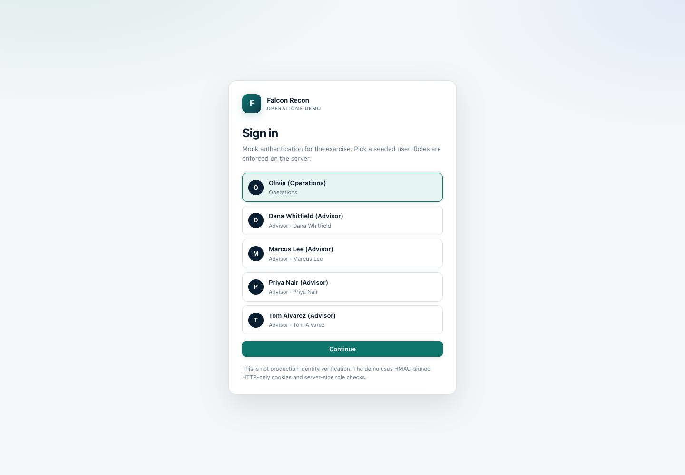
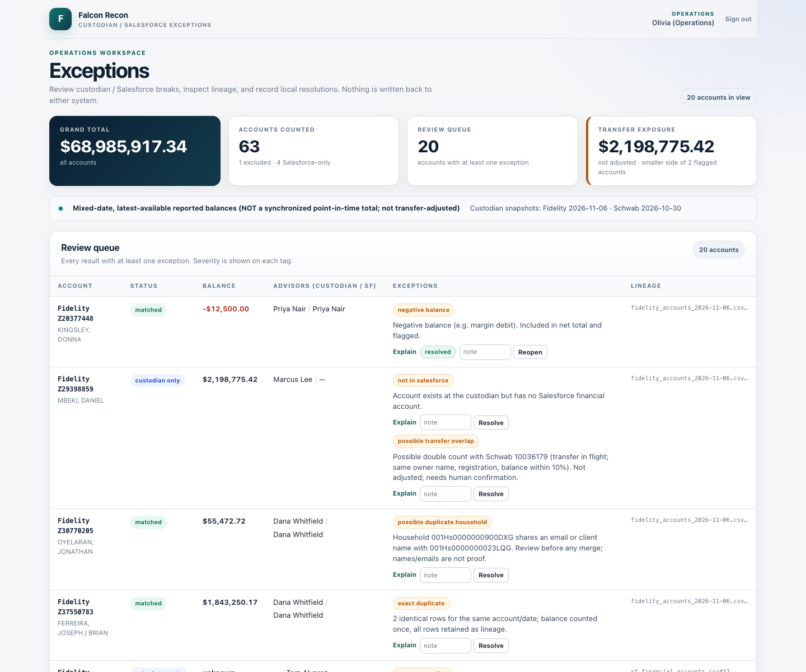

# Falcon Reconciliation — Submission

**Live demo:** <https://falcon-assessment.vercel.app/login>  
**GitHub repository:** <https://github.com/Yi-Jacob/falcon-assessment>  
**Exercise:** Falcon Wealth Planning — Full-Stack Engineer (Internal Apps & AI)  
**Recorded time:** 1 hour 17 minutes (start 16:04:25 PST, end 17:21:25 PST)

## What this is

A small operations tool for the take-home scenario. It ingests the Fidelity, Schwab, Salesforce household/account and rep-code CSVs, keeps an immutable raw layer plus a cleaned canonical model, reconciles accounts across both custodians, reports AUM, and gives Operations an exceptions workspace with mock roles, local approvals, resolutions and an audit trail.

Nothing is written back to Salesforce or either custodian. The AI feature is an offline mock and is advisory only.

## At a glance

| Area | Delivered |
|---|---|
| Ingestion | Five CSVs loaded into SQLite; original bytes and raw rows kept immutable; shared canonical model for both custodians |
| Reconciliation | 68 result rows covering 65 custodian observations and 63 Salesforce accounts; statuses and stacking exception codes |
| AUM | Fidelity 43 accounts / $46,468,120.77; Schwab 20 / $22,517,796.57; total 63 / **$68,985,917.34** |
| Exceptions app | Server-enforced roles; Operations approve/reject/undo and resolve/reopen; before/after audit |
| AI | Offline mock behind an `LlmProvider` interface; strict Zod output; exact prompt shown and logged; never auto-applied |
| Tests | 26 Vitest tests; TypeScript and Next build clean |
| Docs | `README.md`, `MAPPING.md`, `AI_NOTES.md`; this summary document |

## Screenshots

### Sign-in

The live demo uses seeded mock users: Operations plus one user per advisor.

{width=5.8in}

### Operations workspace

The workspace shows the AUM summary, review queue, lineage, proposal forms, proposed changes and audit log.

{width=6.6in}

## AUM summary

Mixed-date, latest-available reported balances. This is not a synchronized point-in-time total and it is not transfer-adjusted.

| Custodian | Row as-of | Accounts counted | Balance |
|---|---|---|---|
| Fidelity | 2026-11-06 | 43 | $46,468,120.77 |
| Schwab | 2026-10-30 | 20 | $22,517,796.57 |
| **Grand total** | mixed | **63** | **$68,985,917.34** |

| Advisor (custodian rep-code mapping) | Accounts | Balance |
|---|---|---|
| Dana Whitfield | 17 | $17,084,275.44 |
| Marcus Lee | 16 | $15,662,603.12 |
| Priya Nair | 14 | $15,045,373.06 |
| Tom Alvarez | 15 | $18,787,229.80 |
| Unassigned (Schwab `RX99`) | 1 | $2,406,435.92 |

Coverage: 64 distinct custodian accounts; 63 counted; 1 blank balance excluded; 1 exact duplicate collapsed; 1 negative balance included; 4 Salesforce-only accounts not counted; 5 custodian-only accounts included. Status counts: 59 matched, 5 custodian-only, 4 Salesforce-only. 26 exception rows.

The transfer-overlap review pair has combined flagged balances of $4,409,175.42; the potential double count is the smaller side, **$2,198,775.42**. It is flagged, not adjusted.

## Data and reconciliation decisions

- **Raw data is immutable.** Original file bytes are stored as a SHA-256-keyed BLOB, and raw rows retain unmodified string values. Triggers block updates and deletes on `raw_files`, `raw_rows` and `import_batches`.
- **One canonical model for both custodians.** `custodian_observations` stores one row per source row, with valuation date and raw-row lineage.
- **Account identity is `(custodian, normalized account number)`.** Only hyphens and spaces are removed; letters and leading zeros are kept. Schwab `08855469` and Salesforce `8855469` are flagged as a possible typo, not linked.
- **Money is integer cents.** There is no floating-point money arithmetic.
- **Blank balance is unknown, not zero.** Negative balances are included and flagged.
- **Dates come from the rows, not the filenames.** Missing or unparseable dates are flagged `missing_valuation_date`; a lone undated row is counted with an unknown as-of date, and undated rows are lineage when dated rows exist.
- **Duplicates.** Exact duplicates are counted once with all lineage kept. Conflicting same-date duplicates are excluded with no winner. An exact duplicate in the Fidelity file is collapsed.
- **No weak auto-links.** Names, emails, tax IDs, SSN fragments and missing leading zeros are review signals only. They never link accounts.
- **Advisor attribution.** AUM follows the custodian rep-code mapping. The exception table follows Salesforce-household visibility. The one advisor-mismatch account is shown to its Salesforce-household advisor and attributed to the custodian-rep advisor.
- **Transfer overlap.** The Schwab trust account marked “Transferring” with an ACAT note is paired with the similar Fidelity trust account. Both are flagged; nothing is removed. The 10% tolerance is a heuristic and is documented as such.

## Security and AI safety

- Mock sign-in uses an HMAC-signed, HTTP-only cookie. Roles are enforced in server pages and server actions; the cookie only holds a seeded user id.
- Advisors cannot view, explain, propose against, or resolve another advisor’s data. Operations-only actions are checked server-side.
- Approvals and resolutions write local audit rows with before/after JSON. Approvals can be undone. Nothing is written back to Salesforce or a custodian.
- Production refuses to sign a session cookie without `SESSION_SECRET`. `COOKIE_SECURE=1` enables the Secure flag behind HTTPS.
- The AI prompt contains only structured, minimised fields. Tax IDs, SSN fragments, emails, Salesforce notes and free-text exception reasons are excluded; the account number is masked. Output is strict-Zod-validated with a safe fallback, and there is no code path that applies it.
- The prompt-injection text in the Salesforce notes is treated as data, flagged `suspicious_note_content`, and never sent to the model.

## Verification

- `npm test`: **26/26 passed**.
- `npx tsc --noEmit`: clean.
- `npm run build`: clean.
- `npm run ingest` twice: first run imports five files; second run is all `skipped_identical`, reuses the run, and creates no extra batch.
- `npm run report`: totals, coverage, status counts and 26 exceptions match the tables above.
- Independent Python `Decimal` recomputation from the raw CSVs matched the AUM totals to the cent.
- HTTP smoke test: Operations saw 26 exception rows and the audit log; Dana saw 6 and no audit log; a forged cookie redirected to login.
- The UI was checked with headless Chrome screenshots at desktop size.

## Known gaps / next

- Approved link/merge overrides are stored but not yet re-applied to reconciliation output. Exception resolve/reopen is local and audited.
- The propose/approve/undo and resolve/reopen flows were tested through unit tests and server-function calls, not clicked manually in a browser.
- Schwab “Contributory IRA” → traditional is an assumption to confirm with Operations.
- The 10% transfer tolerance is a heuristic.
- With more time: per-row valuation dates for mixed-date files, fuzzy typo candidates beyond leading zeros, a browser test, real SSO/CSRF review, and a real LLM provider behind the existing interface.

## Run locally

```bash
npm install
npm run ingest
npm run report
npm test
npm run build && FALCON_DB=$PWD/falcon.db SESSION_SECRET=dev-only-mock-secret-change-me npx next start -p 3111
```

Open <http://localhost:3111>. Signed-in users are seeded; Operations can see all data, advisors see their own households.

## Links

- **Live demo:** <https://falcon-assessment.vercel.app/login>
- **GitHub:** <https://github.com/Yi-Jacob/falcon-assessment>
- **README:** `README.md` in the repository
- **Field mapping:** `MAPPING.md`
- **AI notes:** `AI_NOTES.md`
